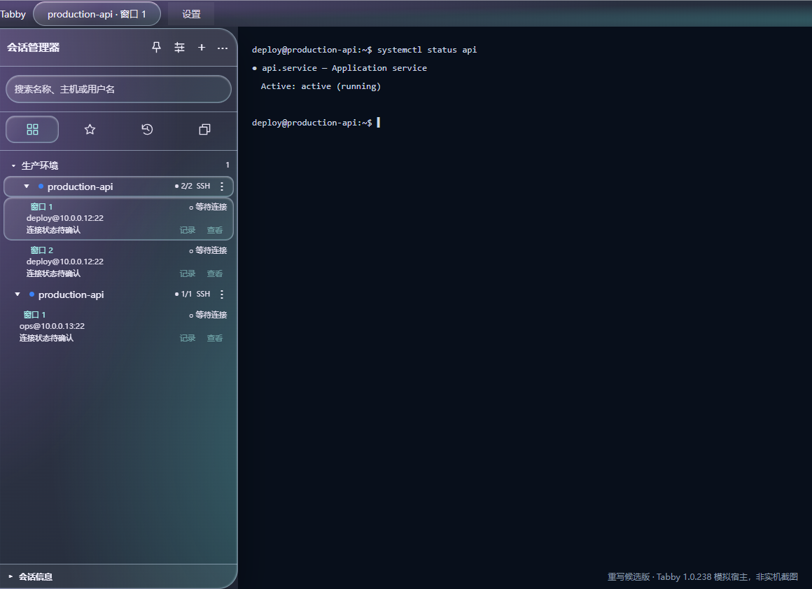
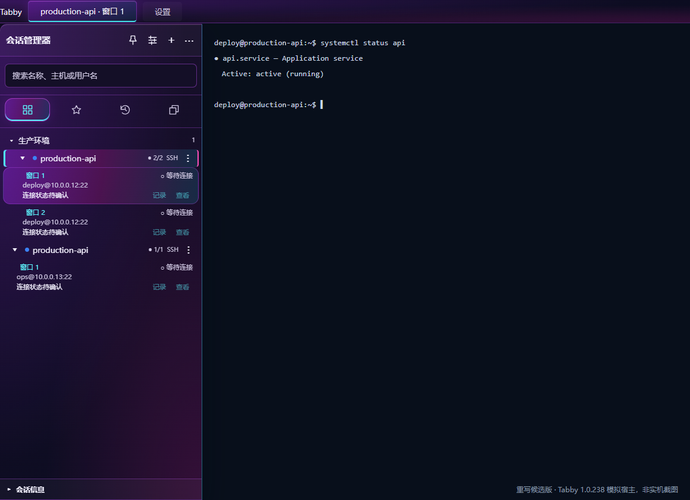

# Tabby Session Suite 4.0.0

[简体中文](README.md)

An independently reimplemented release that replaces the supplied Manus-era session manager, logging engine, logging settings page and sidebar stylesheet. It does not load the original plugins or include a hidden fallback copy.

Maintains session/folder management, favorites, independent recent-history cleanup, per-window identity and focus, automatic/manual logging with stop/resume/new-file controls, saved paths and old-log discovery, eight themes, Chinese/English, imports, selective backups, forwarding configuration/diagnostics, bulk actions, undo and the existing hotkey.

Existing sessionManager and autoSessionLogger keys, profile IDs, session-log-manager settings ID and mapping paths are retained. No existing logs or saved credentials are deliberately deleted or renamed. Log names retain the datetime_session_shortid.log format with exclusive file creation.

The maintainer tried the rewritten version in the existing Windows / Tabby 1.0.238 environment and reported no issues. Sixteen verification scripts and four browser fixture suites also pass. Other hosts/platforms and npm installation, standard-directory migration, uninstall and rollback remain separate acceptance items. Publication has not been executed. Preserve v3.6.0 for rollback.

Quit Tabby and replace the same-name plugin directory while keeping configuration, credentials and logs. Restore synchronized terminal colors before uninstalling or rolling back. Avoid duplicate plugin copies and the old standalone logger.

Build: node scripts/build.cjs. Verify: node scripts/verify.cjs. Optional UI tests use the pinned Playwright development dependency and Windows Edge. No original plugin or Manus service is needed to build. Tabby supplies Angular and its host modules; do not bundle a separate copy.

Apache-2.0, maintained by Bingbing (bingbing-QQ), with applicable upstream and historical MIT notices retained. This is not a clean-room or legal-originality certification: prior implementation was inspected for compatibility. See docs/REIMPLEMENTATION.md and the privacy/security notices. No GitHub upload or npm publication has been performed.

[Installation](docs/INSTALL.md) · [Changelog](CHANGELOG.md) · [Compatibility](docs/COMPATIBILITY.md) · [Publishing](docs/PUBLISHING.md)

## Preview

Synthetic previews rendered from the accepted candidate code; release behavior is unchanged. These are not native Tabby screenshots.

